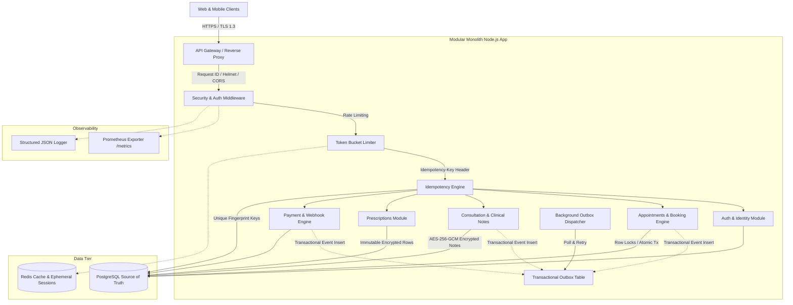
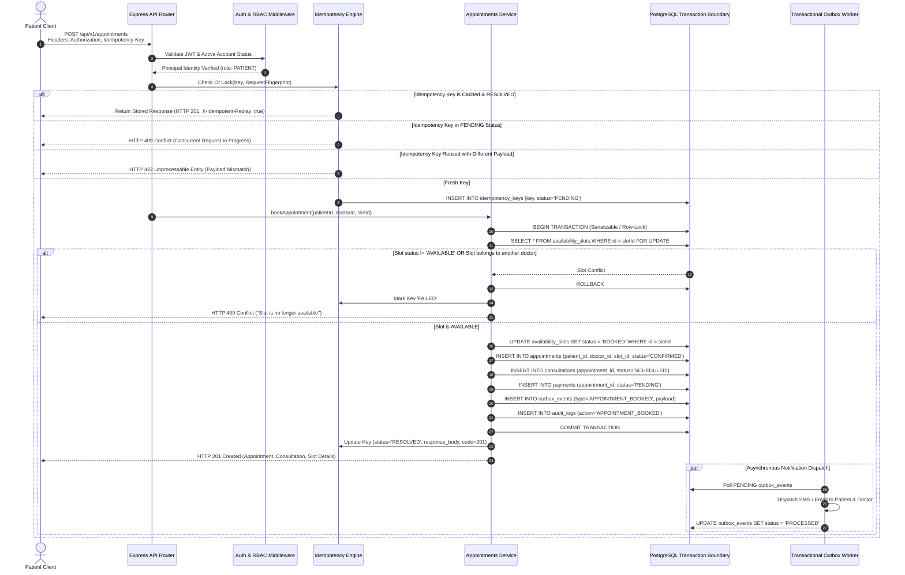
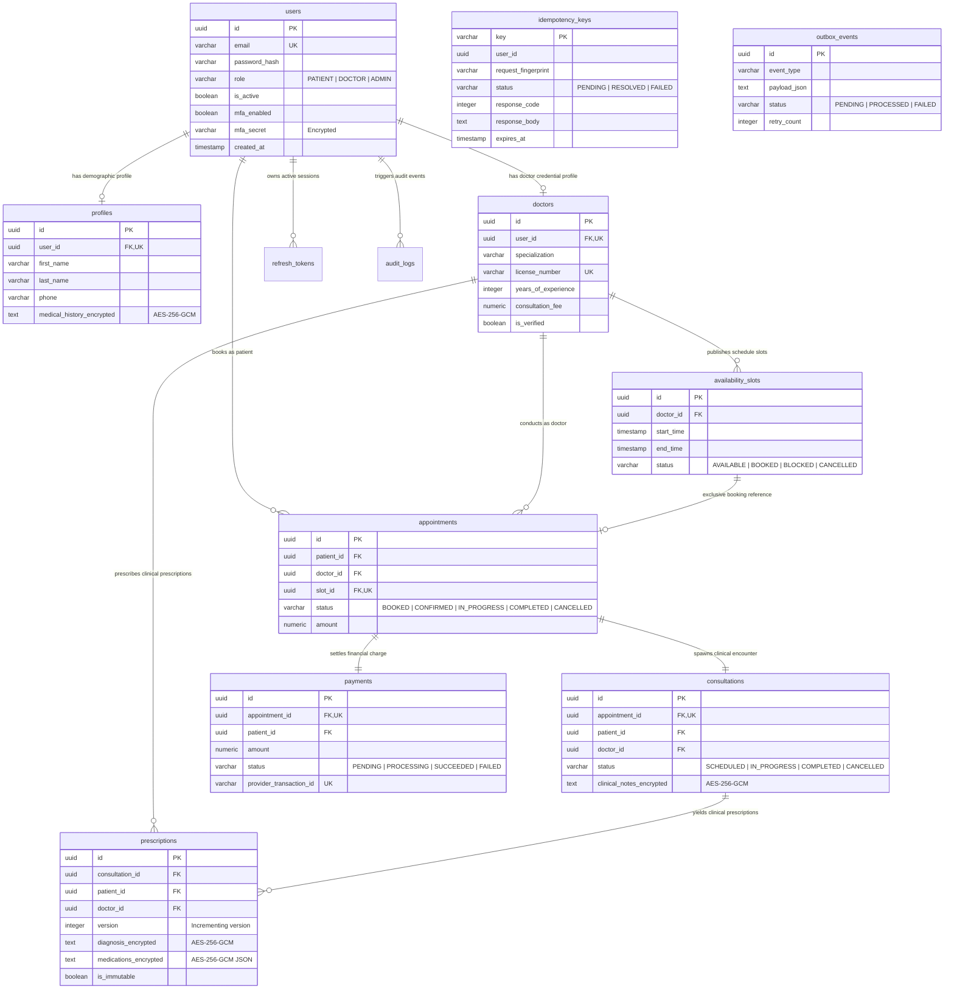

# Amrutam Telemedicine Backend — Architecture & System Design Document

**Document Version:** 1.0.0  
**Status:** Approved for Technical Evaluation  
**Author:** Principal Backend & System Architecture Team  
**Scope:** Core Telemedicine Platform (Identity, Doctor Availability, Concurrent Booking, Consultations, Prescriptions, Payments, Observability)

---

## 1. Executive Summary & Problem Scope

Amrutam is a high-scale Ayurvedic telemedicine platform connecting patients across geographies with certified Ayurvedic practitioners. The backend system serves as the foundational source of truth for:
* User lifecycle management, Argon2id/bcrypt identity authentication, and Time-based One-Time Password (TOTP) Multi-Factor Authentication.
* Role-Based Access Control (`PATIENT`, `DOCTOR`, `ADMIN`) with strict object-level tenant authorization (Anti-IDOR).
* Timezone-aware doctor availability management and continuous slot generation.
* **Concurrent, double-booking protected appointment scheduling** with atomic database transaction boundaries.
* The clinical consultation lifecycle (`SCHEDULED` &rarr; `IN_PROGRESS` &rarr; `COMPLETED`) with field-level encrypted clinical records.
* Immutable, versioned clinical prescriptions with prescriber authorization checks and AES-256-GCM encryption of sensitive diagnoses and medication schedules.
* Financial lifecycle tracking with idempotent payment intent creation and HMAC-SHA256 verified webhook processing.
* Real-time operational analytics and compliance audit trails.

---

## 2. High-Level Architecture & Data Flow

The platform is designed as a **Modular Monolith**. This eliminates distributed transaction hazards (e.g. 2PC overhead, dual-write split-brain, and network partitions) while preserving strict modular boundaries:

---

## 3. Booking Flow Sequence Diagram (Atomic Concurrency Control)

The booking engine constitutes the critical correctness boundary of the telemedicine platform. The sequence below illustrates how race conditions, simultaneous double bookings, and duplicate submissions are prevented:

---

## 4. Entity-Relationship (ER) Diagram

The database architecture is fully normalized (3NF) and enforces referential integrity through foreign keys, check constraints, and unique indexes:

---

## 5. Capacity Sizing & Performance Model (100,000 Consultations / Day)

### 5.1 Throughput & Traffic Burst Model
* **Daily Consultation Target:** 100,000 consultations per day.
* **Peak Traffic Ratio:** Healthcare consultations peak during morning hours (08:00–12:00) and evening hours (17:00–20:00). We model an 8-hour active peak window (28,800 seconds).
* **Average Consultations per Second (Peak):** $100,000 / 28,800 \approx 3.47$ completed consultations / sec.
* **Booking Request Multiplier:** Each completed booking involves ~10 read requests (search doctors, fetch availability slots, view profiles) and ~3 write requests (booking intent, payment webhook, consultation lifecycle updates).
  * **Peak Read RPS:** $3.5 \times 10 \approx 35 - 50\text{ RPS}$ (Read p95 target: $< 200\text{ ms}$).
  * **Peak Write RPS:** $3.5 \times 3 \approx 10 - 20\text{ RPS}$ (Write p95 target: $< 500\text{ ms}$).
* **Connection Pooling:**
  * Node.js connection pool sized between 5 and 20 connections per instance.
  * 3 horizontally scaled container instances handle up to 60 concurrent database connections, well below PostgreSQL default limits of 100–200 connections.

---

## 6. Concurrency Control & Double-Booking Invariants

1. **Database-Level Exclusivity:**
   * Unique constraint `uq_doctor_slot_start` on `availability_slots(doctor_id, start_time)` prevents overlapping duplicate slots.
   * Unique constraint on `appointments(slot_id)` guarantees at the relational engine level that no slot can ever have more than one active appointment.
2. **Transaction Isolation & Row Locking:**
   * Booking logic runs inside an atomic `db.transaction()` block.
   * `SELECT FOR UPDATE` locks the slot row, ensuring that serial transactions cannot observe an intermediate `AVAILABLE` state while another transaction is committing.
3. **Double-Booking Verification:**
   * Automated concurrency suite (`tests/concurrency/double_booking.test.ts`) executes concurrent asynchronous `Promise.all` requests against the same slot, proving that exactly one request succeeds (HTTP 201) while all racing duplicates are rejected with HTTP 409 Conflict.

---

## 7. Idempotency Architecture

Every mutating endpoint (`/api/v1/appointments`, `/api/v1/payments`, `/api/v1/prescriptions`) accepts an optional or required `Idempotency-Key` HTTP header:
1. **Canonical Fingerprinting:** The request method, path, and sorted JSON body are digested with SHA-256 (`generateRequestFingerprint`).
2. **State Locking:** The key is inserted into `idempotency_keys` with `status = 'PENDING'`.
3. **Collision Detection:**
   * If a second request arrives with the same key while `PENDING`, it is rejected with **HTTP 409 Conflict** to prevent concurrent race conditions.
   * If a request arrives with an existing key but a modified payload, it is rejected with **HTTP 422 Unprocessable Entity**.
   * If the key is already `RESOLVED`, the stored response payload and HTTP status code are served directly with the header `X-Idempotent-Replay: true`.

---

## 8. Sensitive Health Information Protection & Encryption

* **Data at Rest:** Critical Protected Health Information (PHI) fields are encrypted using authenticated **AES-256-GCM** with unique 96-bit IVs and 128-bit authentication tags:
  * `profiles.medical_history_encrypted`
  * `consultations.clinical_notes_encrypted`
  * `prescriptions.diagnosis_encrypted`
  * `prescriptions.medications_encrypted`
* **Data in Transit:** TLS 1.3 encryption across all public ingress boundaries.
* **Redaction in Observability:** Passwords, JWT secrets, authentication tags, credit cards, and MFA secrets are redacted at the root logger level (`src/common/observability/logger.ts`).

---

## 9. Transactional Outbox Pattern & Asynchronous Operations

To prevent dual-write inconsistencies between database commits and message publication (e.g., appointment saved in DB, but email notification fails), the **Transactional Outbox Pattern** is utilized:
* Events (`APPOINTMENT_BOOKED`, `CONSULTATION_COMPLETED`, `PRESCRIPTION_ISSUED`, `PAYMENT_SUCCEEDED`) are inserted into `outbox_events` within the exact same database transaction as the business entity.
* A background loop (`src/server.ts` / `OutboxService`) continuously reads `PENDING` outbox records, dispatches notifications, and updates the status to `PROCESSED` with exponential backoff on retries.

---

## 10. Operational Readiness, Backups & Disaster Recovery

* **RPO (Recovery Point Objective):** $\le 5$ minutes via continuous PostgreSQL Write-Ahead Log (WAL) archiving.
* **RTO (Recovery Time Objective):** $\le 30$ minutes via containerized infrastructure and automated restore scripts.
* **Health Checks:** Separate `/health/live` (process health) and `/health/ready` (database connectivity probe).
* **Metrics:** Prometheus scrape target exposed at `/metrics` reporting low-cardinality HTTP latency histograms, error rates, and booking outcomes.
